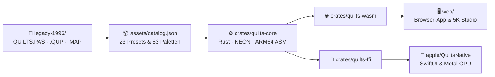

# Quilts – Symmetric Chaos on the Torus (1996 → 2026)

<p align="center">
  <a href="#deutsch">🇩🇪 <strong>Deutsch</strong></a> &nbsp;·&nbsp; <a href="#english">🇬🇧 <strong>English</strong></a>
</p>

<p align="center">
  
  <br />
  <em>Hexagonaler Quilt (𝔻₆-Symmetrie) mit der klassischen Fractint-Palette <code>VOLCANO3.MAP</code> · Hexagonal quilt (𝔻₆ symmetry) rendered with the classic Fractint palette <code>VOLCANO3.MAP</code>.</em>
</p>

---

<a id="deutsch"></a>
## 🇩🇪 Deutsch

Periodische chaotische Attraktoren (*„Symmetric Quilts“*) und symmetrische Abbildungen nach **Michael Field** und **Martin Golubitsky** – von einer MS-DOS-Implementierung in Turbo Pascal aus dem März 1996 in die moderne Welt übertragen.

### 👤 Autor & KI-Unterstützung

Quilts wurde von Stefan Wolfrum entwickelt, mit KI-Unterstützung durch Google Gemini:

- **Stefan Wolfrum** ([@metawops](https://github.com/metawops))  
  *Idee, mathematische Konzeption, Original-Implementierung 1996 in Borland Turbo Pascal (`QUILTS.PAS`), UI-Design, Kuration historischer Presets & Paletten und Weiterentwicklung.*
- **Google Gemini** (Google DeepMind)  
  *KI-Pair-Programming via Google Antigravity: Dekodierung des 16-Bit Pascal-Codes, mathematische Formalisierung der Hexagonal-Kachelung, Rust/Wasm SIMD128-Engine, Web-Worker-Multithreading, Ultra-HD Wallpaper Studio und Web-Benutzungsoberfläche.*

---

### Persönliche Historie: März 1996 bis heute

Im **März 1996** entstand die ursprüngliche Version dieses Programms – **`QUILTS.PAS` (Quilts V1.1)** – in **Borland Turbo Pascal** unter **MS-DOS**. Inspiriert durch das Buch *Symmetry in Chaos* (dt. *Chaotische Symmetrien*) von Michael Field und Martin Golubitsky war das Ziel, die darin beschriebenen periodischen Torus-Attraktoren („Quilts“) selbst zu berechnen, interaktiv zu erforschen und hochauflösend einzufärben.

#### Technische Eckdaten des Originals von 1996 ([`legacy-1996/QUILTS.PAS`](legacy-1996/QUILTS.PAS))
- **Umgebung & Grafik:** Rund 2.233 Zeilen Turbo Pascal mit dem BGI-Treiber `SVGA256.BGI` für 256-Farben-SVGA-Auflösungen unter MS-DOS.
- **Zwei Symmetriegitter:** Vollständige Implementierung sowohl **quadratischer Quilts** (`iterateQuad`, 𝔻₄- bzw. ℤ₄-Symmetrie auf dem Einheitsquadrat) als auch **hexagonaler Quilts** (`iterateHex`, 𝔻₆- bzw. ℤ₆-Symmetrie auf dem hexagonalen Gitter).
- **2D-Dichte-Histogramm & Kachelung:** Während der Iteration wurden die Trefferhäufigkeiten pro Pixel gezählt (`mcount`) und die Grundzelle periodisch zu einem nahtlosen $n \times n$-Teppich (*Quilt*) gekachelt – wahlweise Punkt für Punkt während der Rechnung oder im schnellen Block-Kopiermodus (`fastMode` via `GetImage`/`PutImage`).
- **Farbpaletten & Editor:** Direkte Unterstützung der klassischen `.MAP`-Farbpaletten aus *Fractint* (83 Palettendateien von `ALTERN.MAP` über `FIRESTRM.MAP` und `ROYAL.MAP` bis hin zu eigenen Kreationen wie `STEFAN1.MAP`) sowie ein direkt in die SVGA-Benutzungsoberfläche integrierter **RGB-Paletten-Editor** mit Farbverlaufs-Interpolation (`[=] create range`) und Schwellenwert-Filterung (`lowBorder`).
- **Parameter-Presets (`.QUP`):** 21 gespeicherte Parameterdateien (`DEFAULT.QUP`, `ABB2_6.QUP` bis `ABBD_9.QUP`), die exakt die Buch-Abbildungen aus *Symmetry in Chaos* rekonstruieren.
- **Bildexport:** Eigener Encoder für unkomprimierte, farbpalettenbasierte 8-Bit-Truevision-TGA-Dateien (`.TGA`), um die berechneten Grafiken verlustfrei abzuspeichern.
- **Erster Windows-Ansatz (April 1996):** Nur wenige Wochen später entstand im April 1996 ein erster Entwurf einer ereignisgesteuerten Windows-Benutzungsoberfläche in **Borland Delphi** (`uMain.pas`, `uMatPara.pas`, `uImgPara.pas`), der jedoch ein unvollendeter Prototyp blieb.

---

### Quilts V2.0 (2026): Modulare Architektur & High-Speed-Features

Fast genau dreißig Jahre nach den ersten Zeilen in Turbo Pascal wurden alle Originaldateien von einer alten Diskette gerettet und in einer modernen, modularen Multi-Target-Architektur neu implementiert:

#### 1. 🖼 5K / Dual-5K Ultra-HD Wallpaper Studio
Da die chaotischen Attraktoren auf dem Torus doppelt-periodisch sind, lassen sie sich ohne jede geometrische Verzerrung auf beliebige Breitbild-Formate (16:9, 32:9, 4:3, 1:1) kacheln:
- **Dual 5K Multi-Monitor Split (`2× 5120×2880 px`):** Berechnet ein nahtlos verbundenes $10240 \times 2880$-Panorama ($32:9$, 29,5 Megapixel) und exportiert automatisch zwei passgenau aneinander anschließende 5K-PNG-Dateien (`_5K_LEFT` und `_5K_RIGHT`) für zwei nebeneinander stehende 5K-Monitore.
- **Weitere Direkt-Presets:** Apple 5K Studio Display ($5120 \times 2880$), Apple 6K Pro Display XDR ($6016 \times 3384$), 4K UHD ($3840 \times 2160$), iPad Pro 13" ($2752 \times 2064$) und 4K-Kunstdruck-Quadrat ($4096 \times 4096$).
- **Sofort-Export & Exaktes Quantil-/CDF-Color-Matching:** Wahlweise wird direkt das im Hauptfenster über Milliarden Iterationen gereifte, rauschfreie Live-Histogramm mit bilinearer Subpixel-Kantenglättung in unter einer Sekunde exportiert – oder ein eigenes Ultra-HD-Histogramm ($1440 \times 1440$ bzw. $2048 \times 2048$ Pixel pro Einzelkachel) neu berechnet und über *Cumulative Distribution Function (CDF) Matching* exakt auf die Farbverteilung des Live-Bildes abgeglichen.
- **Live-Kompositionsvorschau:** Freie Wahl der vertikalen Kachel-Wiederholungen sowie horizontaler/vertikaler Phasen-Verschiebung $(u_0, v_0)$ mit eingezeichneter Monitor-Trennlinie.

#### 2. ⚡ Multi-Backend Hardware-Benchmark-Arena
Um zu erforschen und direkt zu messen, welchen Geschwindigkeitsgewinn moderne Compiler-, Vektor- und GPU-Technologien gegenüber dem 1996er Algorithmus erzielen, lassen sich verschiedene Rechen-Backends live umschalten und in einer integrierten **Benchmark-Arena** gegeneinander vermessen (Durchsatz in **Millionen Iterationen pro Sekunde, MIt/s**):

| Zielplattform | Verfügbare Compute-Engines | Technische Besonderheiten |
| :--- | :--- | :--- |
| **Rust Core (`crates/quilts-core`)** | 1. `Scalar1996`<br>2. `ScalarFastTrig`<br>3. `Simd4xMultiOrbit`<br>4. `Arm64HandAssembly`<br>5. `MultiCoreParallel` | • 1:1 Turbo-Pascal-Referenz<br>• Verzweigungsfreies Modulo-1 (`floor`) + Chebyshev-Rekursion<br>• Hardware-SIMD (**ARM64 NEON Intrinsics** / **x86 AVX2** / **Wasm SIMD128**)<br>• Handgeschriebener **ARM64-NEON-Inline-Assembler (`asm!`)** mit Register-Pinning (`v0..v28`), `frintm.4s` & `fmla.4s`<br>• Multi-Thread-Skalierung über alle Performance-Kerne |
| **Moderne Web-App (`web/`)** | 1. `Pascal 1996 Skalar`<br>2. `JS Branchless + Chebyshev`<br>3. `Rust / WebAssembly`<br>4. `Multi-Core Web Worker Pool` | • Zero-Build ES-Module & Transferable `Uint32Array`-Buffers<br>• Parallele Berechnung auf allen CPU-Kernen via Web Workers (~150–250+ MIt/s im Browser auf Apple M4 Pro) |
| **Native Apple App (`apple/QuiltsNative`)** | 1. `Pascal 1996 Scalar`<br>2. `Swift SIMD4`<br>3. `Apple Accelerate (vForce)`<br>4. `Apple Metal GPU Compute` | • Native SwiftUI-Benutzungsoberfläche für macOS, iPadOS & iOS<br>• **Metal Compute Shader** ([`QuiltsCompute.metal`](apple/QuiltsNative/Sources/QuiltsCompute.metal)) mit 16.384 parallelen GPU-Trajektorien, Hardware-SFU `fast::sin`/`cos` und `atomic_uint`-Akkumulation im Unified Memory |

#### 3. 🎨 Interaktive Echtzeit-Benutzungsoberfläche
- **23 historische `.QUP`-Presets & 83 Fractint `.MAP`-Paletten:** Direkt integriert in [`assets/catalog.json`](assets/catalog.json) und [`web/assets-data.js`](web/assets-data.js).
- **Verzögerungsfreie Paletten-Manipulation:** Genau wie 1996 über die VGA-DAC-Register (`Port[$3c8]`) wirken Palettenwechsel (inkl. Live-Hover-Preview!), `lowBorder`, `blackIndex`, Kontrast/Gamma, Echtzeit-Farbrotation (*Color Cycling*) und der Wechsel zwischen klassischem 1996er-Clamping (`<= 254`) und logarithmischem HDR-Tone-Mapping in Echtzeit ohne Neu-Iteration.
- **16×16 RGB-Paletten-Editor:** Nachbildung von `colorEdit` aus `QUILTS.PAS` mit Farbmarkierung, Verlaufs-Interpolation (`[=] Spread`), Kopieren/Tauschen und `.MAP`-Export.
- **Originalgetreuer `.TGA`-, `.PNG`- & `.QUP`-Export:** Exportiert sowohl hochauflösende PNGs als auch unkomprimierte, farbpalettenbasierte 8-Bit-Truevision-TGA-Dateien nach der Spezifikation von 1996.

---

### Architektur & Projektstruktur



| Verzeichnis / Pfad | Inhalt & Aufgabe |
| :--- | :--- |
| **[`assets/`](assets/)** | [`catalog.json`](assets/catalog.json) (alle 23 `.QUP`-Presets & 83 `.MAP`-Paletten) sowie [`examples/`](assets/examples/) (Showcase-Galerie) |
| **[`crates/quilts-core/`](crates/quilts-core/)** | Plattformunabhängiger Rust-Rechenkern (`Scalar1996`, `ScalarFastTrig`, `Simd4xMultiOrbit`, `Arm64HandAssembly`, `MultiCoreParallel`) & Widescreen-Renderer |
| **[`crates/quilts-ffi/`](crates/quilts-ffi/)** | Zero-Copy C-ABI-Brücke inkl. Header [`quilts_ffi.h`](crates/quilts-ffi/include/quilts_ffi.h) für Swift/Xcode |
| **[`crates/quilts-wasm/`](crates/quilts-wasm/)** | WebAssembly-Wrapper (`wasm32-unknown-unknown`) für Browser |
| **[`web/`](web/)** | Moderne Web-App (HTML5 2D-Canvas, Multi-Core Web Worker Pool, **5K / Dual-5K Wallpaper Studio**, 16×16 Paletten-Editor & Benchmark-Arena) |
| **[`apple/QuiltsNative/`](apple/QuiltsNative/)** | Natives Swift / SwiftUI Projekt für macOS, iPadOS & iOS (`SIMD4`, Apple `Accelerate` & Metal GPU Compute Shader [`QuiltsCompute.metal`](apple/QuiltsNative/Sources/QuiltsCompute.metal)) |
| **[`legacy-1996/`](legacy-1996/)** | Gerettete Originaldateien von März/April 1996 ([`QUILTS.PAS`](legacy-1996/QUILTS.PAS), `.QUP`, `.MAP`, Delphi-Prototyp) |

---

### Schnellstart

#### 1. Web-App im Browser starten (Safari, Chrome, Firefox)
```zsh
python3 -m http.server 8080 --directory web
```
Anschließend im Browser [`http://localhost:8080`](http://localhost:8080) öffnen.

#### 2. Rust-Rechenkern & CLI-Benchmark-Arena ausführen
```zsh
cargo run --release -p quilts-core --bin bench_arena
```

#### 3. Native macOS / iPadOS App (Swift & Metal GPU) starten
```zsh
cd apple/QuiltsNative
swift run -c release
```

---

### Mathematischer Hintergrund

Die zugrunde liegende Mathematik verbindet **chaotische dynamische Systeme** mit **diskreten Symmetriegruppen** in der Ebene ($\mathbb{R}^2 \cong \mathbb{C}$) und auf dem zweidimensionalen Torus ($\mathbb{T}^2 = \mathbb{R}^2 / \mathcal{L}$). Obwohl einzelne Trajektorien empfindlich von den Anfangsbedingungen abhängen (Chaos), besitzt das invariante Maß des Attraktors im Grenzwert vieler Iterationen exakt die Symmetrie der zugrunde liegenden Gruppe $\Gamma$.

#### 1. Symmetrische Torus-Abbildungen („Quilts“)

Betrachtet wird der zweidimensionale Torus $\mathbb{T}^2 = \mathbb{R}^2 / \mathcal{L}$, wobei $\mathcal{L}$ ein ebenes Gitter ist (das Einheitsquadrat-Gitter $\mathbb{Z}^2$ oder das hexagonale Gitter). Eine Abbildung $g: \mathbb{T}^2 \to \mathbb{T}^2$ lässt sich zu einer Abbildung $f: \mathbb{R}^2 \to \mathbb{R}^2$ der Form

$$f(X) = p(X) + L(X)$$

liften, wobei $p(X + \ell) = p(X)$ für alle $\ell \in \mathcal{L}$ doppelt-periodisch ist und $L$ eine lineare Abbildung bezeichnet, die das Gitter $\mathcal{L}$ invariant lässt. Fordert man, dass $f$ mit der Symmetriegruppe (Holohedrie) des Gitters kommutiert (bzw. bis auf Drehsymmetrie kommutiert), entstehen bei der Iteration $X_{k+1} = f(X_k) \bmod \mathcal{L}$ beschränkte chaotische Attraktoren, die sich periodisch in der Ebene als nahtlose **Quilt-Muster** aneinanderfügen lassen.

##### A. Quadratische Quilts (𝔻₄- und ℤ₄-Symmetrie)
Auf dem Einheitsgitter $[0, 1)^2$ lautet die im Artikel *Symmetric Chaos* von Field & Golubitsky (1990, [DOI: 10.1063/1.4822939](https://doi.org/10.1063/1.4822939), Gleichung 1f) eingeführte Grundform der Symmetriegruppe $\mathbb{D}_4$:

$$f(x, y) = \lambda \begin{pmatrix} \sin(2\pi x) \\ \sin(2\pi y) \end{pmatrix} + \alpha \begin{pmatrix} \sin(2\pi x)\cos(2\pi y) \\ \sin(2\pi y)\cos(2\pi x) \end{pmatrix} + \beta \begin{pmatrix} \sin(4\pi x) \\ \sin(4\pi y) \end{pmatrix} + \gamma \begin{pmatrix} \sin(6\pi x)\cos(4\pi y) \\ \sin(6\pi y)\cos(4\pi x) \end{pmatrix} + m \begin{pmatrix} x \\ y \end{pmatrix} \pmod 1$$

In *Symmetry in Chaos* (1992) und in `QUILTS.PAS` (`iterateQuad`) ist diese Vorschrift zusätzlich um einen **Chiralitäts-/Symmetriebrechungsterm** $\omega$ (bricht die Spiegelsymmetrie von $\mathbb{D}_4$ auf die reine Vierfach-Drehsymmetrie $\mathbb{Z}_4$) sowie eine **Gitterverschiebung** $\mathrm{shift}$ erweitert:

$$x_{\mathrm{neu}} = \bigl((\lambda + \alpha \cos(2\pi y))\sin(2\pi x) - \omega \sin(2\pi y) + \beta \sin(4\pi x) + \gamma \sin(6\pi x)\cos(4\pi y) + m \cdot x + \mathrm{shift}\bigr) \bmod 1$$

$$y_{\mathrm{neu}} = \bigl((\lambda + \alpha \cos(2\pi x))\sin(2\pi y) + \omega \sin(2\pi x) + \beta \sin(4\pi y) + \gamma \sin(6\pi y)\cos(4\pi x) + m \cdot y + \mathrm{shift}\bigr) \bmod 1$$

mit reellen Parametern $\lambda, \alpha, \beta, \gamma, \omega, \mathrm{shift} \in \mathbb{R}$ und ganzzahligem Gitterfaktor $m \in \mathbb{Z}$.

##### B. Hexagonale Quilts (𝔻₆- und ℤ₆-Symmetrie)
Auf dem hexagonalen Gitter mit den Basisvektoren $k_1 = (1, 0)^T$ und $k_2 = \bigl(\tfrac{1}{2}, \tfrac{\sqrt{3}}{2}\bigr)^T$ nutzt `iterateHex` drei um $120^\circ$ gedrehte Wellenvektor-Systeme erster, zweiter und dritter harmonischer Ordnung. Die Iteration koppelt den linearen Gitteranteil $(a x - b y,\; a y + b x)$ mit den trigonometrischen Summen der Parameter $\lambda, \alpha, \beta, \gamma, \omega$, transformiert die Koordinaten über

$$b_y = \frac{2}{\sqrt{3}}\, y_{\mathrm{neu}}, \qquad b_x = x_{\mathrm{neu}} - \frac{1}{2}\, b_y$$

in das schiefwinklige Fundamentalgebiet $[0, 1)^2$, reduziert modulo $1$ und projiziert für den nächsten Iterationsschritt zurück in kartesische Koordinaten.

---

#### 2. Planare symmetrische Attraktoren („Symmetric Icons“)

Neben den Torus-Abbildungen beschreibt das Paper *Symmetric Chaos* (Field & Golubitsky, 1990) auch die Familie der bezüglich $\mathbb{D}_n$ und $\mathbb{Z}_n$ äquivarianten Abbildungen in der komplexen Ebene $\mathbb{C}$ (mit $u = z\bar{z} = |z|^2$ und $v = z^n$):

$$f(z) = \bigl(\lambda + \alpha u + \beta \mathrm{Re}(v) + \omega i\bigr)z + \gamma \bar{z}^{n-1} + \delta \bigl(\mathrm{Re}((z/|z|)^n)\bigr)^p \frac{z}{|z|}$$

- Für $\omega = 0$ und $\delta = 0$ ergibt sich die klassische polynomiale Familie mit Symmetrie $\mathbb{D}_n$ (Gleichung 1a).
- Für $\omega \neq 0$ wird die Spiegelsymmetrie zu $\mathbb{Z}_n$ gebrochen (Gleichung 1c).
- Für $\delta \neq 0$ entsteht nahe dem Ursprung $z = 0$ eine zusätzliche nicht-polynomiale Skalierungsstruktur (Gleichung 1d).

---

#### 3. Visualisierung über das invariante Maß (Dichte-Färbung)

Sowohl das von Field & Golubitsky entwickelte Programmpaket *Prism* (`iter` & `draw`) als auch `QUILTS.PAS` visualisieren nicht bloß die Punktmenge des Attraktors, sondern dessen **invariantes Maß** (Wahrscheinlichkeitsdichte):

1. Nach dem Verwerfen einer kurzen Einschwingphase (*Transienten*) wird die Abbildung millionenfach iteriert.
2. Für jedes getroffene Pixel $(i, j)$ wird ein Zähler $H(i, j)$ inkrementiert.
3. Da die Trefferverteilung extrem steil verläuft (typischerweise liegen über 95 % aller getroffenen Pixel im Bereich kleiner Trefferzahlen, während scharfe Kaustiken und Faltkanten extrem hohe Spitzenwerte aufweisen), wird die Trefferzahl über Farbpaletten bzw. nichtlineare Farbbänder auf RGB-Werte abgebildet.

---

### Literatur & Referenzen

1. **Originalartikel (1990):**
   - **Mike Field, Martin Golubitsky:** *„Symmetric Chaos: A pictorial exploration of an order imposed by symmetry within chaotic systems“*, in: **Computers in Physics**, Vol. 4, No. 5 (Sep/Oct 1990), S. 470–479. ([DOI: 10.1063/1.4822939](https://doi.org/10.1063/1.4822939))
2. **Das Standardwerk (Hauptquelle für `QUILTS.PAS` und die `.QUP`-Parameterdateien):**
   - **Michael Field, Martin Golubitsky:** *Symmetry in Chaos: A Search for Pattern in Mathematics, Art and Nature*, Oxford University Press, Oxford / New York, **1992**, ISBN 978-0-19-853689-5.
   - **Deutsche Ausgabe:** *Chaotische Symmetrien: Die Suche nach Mustern in Mathematik, Kunst und Natur*, Birkhäuser Verlag, Basel / Boston / Berlin, **1993**, ISBN 978-3-7643-2844-3.
   - **2., überarbeitete Auflage:** *Symmetry in Chaos: A Search for Pattern in Mathematics, Art, and Nature* (2nd Edition), Society for Industrial and Applied Mathematics (SIAM), Philadelphia, **2009**, ISBN 978-0-89871-672-6. ([SIAM Bookstore / DOI: 10.1137/1.9780898717709](https://epubs.siam.org/doi/book/10.1137/1.9780898717709))
3. **Weiterführende mathematische Grundlagen:**
   - **Pascal Chossat, Martin Golubitsky:** *„Symmetry-increasing bifurcation of chaotic attractors“*, in: **Physica D: Nonlinear Phenomena**, Vol. 32, Issue 3 (1988), S. 423–436. ([DOI: 10.1016/0167-2789(88)90066-8](https://doi.org/10.1016/0167-2789(88)90066-8))
   - **Greg King, Ian Stewart:** *„Symmetric Chaos“*, in: *Nonlinear Equations in the Applied Sciences* (W. F. Ames, C. Rogers, Hrsg.), Academic Press, 1992, S. 257–315.

---

### Fractint-Paletten & Urheberrechte

Die im Projekt enthaltenen **83 Farbtabellen** (Dateiformat `.MAP` mit jeweils 256 RGB-Farbtriplets) stammen aus dem legendären Fraktalprogramm **Fractint** der *Stone Soup Group* (Bert Tyler, Timothy Wegner, Mark Peterson, Pieter Branderhorst u. a., 1988–2000). Sie wurden in den 1990er-Jahren von Enthusiasten der weltweiten Fraktal-Community als Freeware beigesteuert.

Die Paletten werden in Quilts V2 zu reinen Dokumentations-, Bildungs- und Nostalgiezwecken bereitgestellt, um das historische visuelle Erscheinungsbild von 1996 originalgetreu wiederzubeleben. Sämtliche Urheberrechte an den individuellen Farbgradienten verbleiben bei den jeweiligen ursprünglichen Autoren.

---

### KI-Pair-Programming mit Google Gemini

Quilts V2 entstand im Oktober 2026 im intensiven Pair-Programming zwischen **Stefan Wolfrum** und **Google Gemini** (Google DeepMind) in der agentischen Entwicklungsumgebung **Google Antigravity**.

Von der Rekonstruktion des historischen 16-Bit Real-Mode Pascal-Codes (`QUILTS.PAS`) über die mathematische Formulierung der hexagonalen Kachelung und bilinearen Subpixel-Glättung bis hin zur hochoptimierten SIMD128-Vektorisierung in Rust/WebAssembly, Multithreading-Architektur mit Web Workern und der interaktiven Web-Benutzungsoberfläche wurde das gesamte System kollaborativ entworfen, implementiert und getestet.

---

### Lizenz

Dieses Projekt steht unter der **MIT License** – siehe [`LICENSE`](LICENSE) für Details (`Copyright (c) 1996, 2026 Stefan Wolfrum`).

---

<a id="english"></a>
## 🇬🇧 English

Periodic chaotic attractors (*"Symmetric Quilts"*) and symmetric mappings after **Michael Field** and **Martin Golubitsky** – ported from an MS-DOS implementation in Turbo Pascal from March 1996 into the modern era.

### 👤 Author & AI Collaboration

Quilts was developed by Stefan Wolfrum, with AI pair programming support by Google Gemini:

- **Stefan Wolfrum** ([@metawops](https://github.com/metawops))  
  *Concept, mathematical formulation, original 1996 Borland Turbo Pascal implementation (`QUILTS.PAS`), UI design, curation of historical presets & palettes, and ongoing development.*
- **Google Gemini** (Google DeepMind)  
  *AI pair programming via Google Antigravity: Decoding 16-bit Pascal code, mathematical formalization of hexagonal tiling, Rust/Wasm SIMD128 engine, Web Worker multithreading, Ultra-HD Wallpaper Studio, and web user interface.*

---

### Personal History: March 1996 to Present

In **March 1996**, the original version of this software – **`QUILTS.PAS` (Quilts V1.1)** – was created in **Borland Turbo Pascal** under **MS-DOS**. Inspired by the book *Symmetry in Chaos* by Michael Field and Martin Golubitsky, the goal was to calculate the doubly periodic torus attractors ("Quilts") described therein, explore them interactively, and color them in high resolution.

#### Technical Specifications of the 1996 Original ([`legacy-1996/QUILTS.PAS`](legacy-1996/QUILTS.PAS))
- **Environment & Graphics:** Approximately 2,233 lines of Turbo Pascal with the `SVGA256.BGI` driver for 256-color SVGA modes under MS-DOS.
- **Two Symmetry Lattices:** Full implementation of both **square quilts** (`iterateQuad`, 𝔻₄ / ℤ₄ symmetry on the unit square) and **hexagonal quilts** (`iterateHex`, 𝔻₆ / ℤ₆ symmetry on the hexagonal lattice).
- **2D Density Histogram & Tiling:** Pixel hit frequencies were accumulated during iteration (`mcount`), and the fundamental cell was tiled periodically into a seamless $n \times n$ tapestry (*Quilt*) – selectable either point-by-point live during computation or via fast block-copy mode (`fastMode` using `GetImage`/`PutImage`).
- **Color Palettes & Editor:** Direct support for classic `.MAP` color palettes from *Fractint* (83 palette files from `ALTERN.MAP` to `FIRESTRM.MAP`, `ROYAL.MAP`, and custom creations like `STEFAN1.MAP`), as well as an **RGB palette editor** directly integrated into the SVGA user interface featuring gradient interpolation (`[=] create range`) and threshold filtering (`lowBorder`).
- **Parameter Presets (`.QUP`):** 21 saved parameter files (`DEFAULT.QUP`, `ABB2_6.QUP` through `ABBD_9.QUP`) accurately reconstructing the figures from *Symmetry in Chaos*.
- **Image Export:** Custom encoder for uncompressed, palette-based 8-bit Truevision TGA files (`.TGA`) for lossless image storage.
- **Early Windows Prototype (April 1996):** Just a few weeks later in April 1996, an early draft of an event-driven Windows user interface was started in **Borland Delphi** (`uMain.pas`, `uMatPara.pas`, `uImgPara.pas`), which remained an unfinished prototype.

---

### Quilts V2.0 (2026): Modular Architecture & High-Speed Features

Nearly thirty years after the first lines of code in Turbo Pascal, all original files were rescued from a vintage floppy disk and re-implemented in a modern, modular multi-target architecture:

#### 1. 🖼 5K / Dual-5K Ultra-HD Wallpaper Studio
Because chaotic attractors on the torus are doubly periodic, they can be tiled across arbitrary widescreen aspect ratios (16:9, 32:9, 4:3, 1:1) without any geometric distortion:
- **Dual 5K Multi-Monitor Split (`2× 5120×2880 px`):** Computes a seamless $10240 \times 2880$ panorama ($32:9$, 29.5 megapixels) and automatically exports two perfectly matching 5K PNG files (`_5K_LEFT` and `_5K_RIGHT`) for dual adjacent 5K displays.
- **Additional Presets:** Apple 5K Studio Display ($5120 \times 2880$), Apple 6K Pro Display XDR ($6016 \times 3384$), 4K UHD ($3840 \times 2160$), iPad Pro 13" ($2752 \times 2064$), and 4K Fine Art Square ($4096 \times 4096$).
- **Instant Export & Exact Quantile / CDF Color Matching:** Either immediately export the live histogram refined over billions of iterations in under one second using bilinear subpixel smoothing – or compute a dedicated Ultra-HD histogram ($1440 \times 1440$ or $2048 \times 2048$ pixels per tile) matched precisely to the live viewport's color distribution via *Cumulative Distribution Function (CDF) Matching*.
- **Live Composition Preview:** Flexible adjustment of vertical tile repetitions, horizontal/vertical phase shifts $(u_0, v_0)$, and a visual monitor split guide overlay.

#### 2. ⚡ Multi-Backend Hardware Benchmark Arena
To evaluate and directly benchmark the speedup achieved by modern compilers, SIMD vectorization, and GPU compute over the 1996 algorithm, various execution backends can be switched live and compared in an integrated **Benchmark Arena** (throughput measured in **million iterations per second, MIt/s**):

| Target Platform | Available Compute Engines | Technical Highlights |
| :--- | :--- | :--- |
| **Rust Core (`crates/quilts-core`)** | 1. `Scalar1996`<br>2. `ScalarFastTrig`<br>3. `Simd4xMultiOrbit`<br>4. `Arm64HandAssembly`<br>5. `MultiCoreParallel` | • 1:1 Turbo Pascal reference<br>• Branchless modulo-1 (`floor`) + Chebyshev recurrence<br>• Hardware SIMD (**ARM64 NEON Intrinsics** / **x86 AVX2** / **Wasm SIMD128**)<br>• Hand-crafted **ARM64 NEON inline assembly (`asm!`)** with register pinning (`v0..v28`), `frintm.4s` & `fmla.4s`<br>• Multi-threaded scaling across all performance cores |
| **Modern Web App (`web/`)** | 1. `Pascal 1996 Skalar`<br>2. `JS Branchless + Chebyshev`<br>3. `Rust / WebAssembly`<br>4. `Multi-Core Web Worker Pool` | • Zero-build ES modules & transferable `Uint32Array` buffers<br>• Parallel computing across all CPU cores via Web Workers (~150–250+ MIt/s in browser on Apple M4 Pro) |
| **Native Apple App (`apple/QuiltsNative`)** | 1. `Pascal 1996 Scalar`<br>2. `Swift SIMD4`<br>3. `Apple Accelerate (vForce)`<br>4. `Apple Metal GPU Compute` | • Native SwiftUI user interface for macOS, iPadOS & iOS<br>• **Metal Compute Shader** ([`QuiltsCompute.metal`](apple/QuiltsNative/Sources/QuiltsCompute.metal)) featuring 16,384 parallel trajectories, hardware SFU `fast::sin`/`cos`, and `atomic_uint` accumulation in Unified Memory |

#### 3. 🎨 Interactive Real-Time User Interface
- **23 Historical `.QUP` Presets & 83 Fractint `.MAP` Palettes:** Fully integrated into [`assets/catalog.json`](assets/catalog.json) and [`web/assets-data.js`](web/assets-data.js).
- **Zero-Latency Palette Manipulation:** Replicating the VGA DAC hardware registers (`Port[$3c8]`) of 1996, palette changes (with live hover preview), `lowBorder`, `blackIndex`, contrast/gamma, real-time color cycling, and switching between classic 1996 clamping (`<= 254`) and logarithmic HDR tone mapping operate instantly without re-iteration.
- **16×16 RGB Palette Editor:** Re-creation of `colorEdit` from `QUILTS.PAS` with color tagging, gradient spreading (`[=] Spread`), swapping, and `.MAP` file export.
- **Faithful `.TGA`, `.PNG` & `.QUP` Export:** Exports high-resolution PNGs as well as uncompressed palette-based 8-bit Truevision TGA files compliant with the 1996 file specification.

---

### Architecture & Project Structure


| Directory / Path | Content & Purpose |
| :--- | :--- |
| **[`assets/`](assets/)** | [`catalog.json`](assets/catalog.json) (all 23 `.QUP` presets & 83 `.MAP` palettes) and [`examples/`](assets/examples/) (showcase gallery) |
| **[`crates/quilts-core/`](crates/quilts-core/)** | Platform-independent Rust compute core (`Scalar1996`, `ScalarFastTrig`, `Simd4xMultiOrbit`, `Arm64HandAssembly`, `MultiCoreParallel`) & widescreen renderer |
| **[`crates/quilts-ffi/`](crates/quilts-ffi/)** | Zero-copy C-ABI bridge with header [`quilts_ffi.h`](crates/quilts-ffi/include/quilts_ffi.h) for Swift/Xcode |
| **[`crates/quilts-wasm/`](crates/quilts-wasm/)** | WebAssembly bindings (`wasm32-unknown-unknown`) for browser deployment |
| **[`web/`](web/)** | Modern web application (HTML5 2D Canvas, Multi-Core Web Worker Pool, **5K / Dual-5K Wallpaper Studio**, 16×16 palette editor & benchmark arena) |
| **[`apple/QuiltsNative/`](apple/QuiltsNative/)** | Native Swift / SwiftUI application for macOS, iPadOS & iOS (`SIMD4`, Apple `Accelerate` & Metal GPU compute shader [`QuiltsCompute.metal`](apple/QuiltsNative/Sources/QuiltsCompute.metal)) |
| **[`legacy-1996/`](legacy-1996/)** | Rescued original files from March/April 1996 ([`QUILTS.PAS`](legacy-1996/QUILTS.PAS), `.QUP`, `.MAP`, Delphi prototype) |

---

### Quick Start

#### 1. Run Web App in Browser (Safari, Chrome, Firefox)
```zsh
python3 -m http.server 8080 --directory web
```
Then open [`http://localhost:8080`](http://localhost:8080) in your web browser.

#### 2. Run Rust Compute Core & CLI Benchmark Arena
```zsh
cargo run --release -p quilts-core --bin bench_arena
```

#### 3. Run Native macOS / iPadOS App (Swift & Metal GPU)
```zsh
cd apple/QuiltsNative
swift run -c release
```

---

### Mathematical Background

The underlying mathematics connects **chaotic dynamical systems** with **discrete symmetry groups** in the plane ($\mathbb{R}^2 \cong \mathbb{C}$) and on the two-dimensional torus ($\mathbb{T}^2 = \mathbb{R}^2 / \mathcal{L}$). Although individual trajectories depend sensitively on initial conditions (deterministic chaos), the invariant measure of the attractor in the limit of many iterations possesses exactly the symmetry of the underlying group $\Gamma$.

#### 1. Symmetric Torus Maps ("Quilts")

Consider the two-dimensional torus $\mathbb{T}^2 = \mathbb{R}^2 / \mathcal{L}$, where $\mathcal{L}$ is a planar lattice (the unit square lattice $\mathbb{Z}^2$ or the hexagonal lattice). A mapping $g: \mathbb{T}^2 \to \mathbb{T}^2$ can be lifted to a mapping $f: \mathbb{R}^2 \to \mathbb{R}^2$ of the form

$$f(X) = p(X) + L(X)$$

where $p(X + \ell) = p(X)$ is doubly periodic for all $\ell \in \mathcal{L}$, and $L$ denotes a linear map preserving the lattice $\mathcal{L}$. When $f$ commutes (or commutes up to rotational symmetry) with the symmetry group (holohedry) of the lattice, iteration $X_{k+1} = f(X_k) \bmod \mathcal{L}$ yields bounded chaotic attractors that tile seamlessly across the plane as **quilt patterns**.

##### A. Square Quilts (𝔻₄ and ℤ₄ Symmetry)
On the unit square $[0, 1)^2$, the basic map with $\mathbb{D}_4$ symmetry introduced in *Symmetric Chaos* by Field & Golubitsky (1990, [DOI: 10.1063/1.4822939](https://doi.org/10.1063/1.4822939), equation 1f) is:

$$f(x, y) = \lambda \begin{pmatrix} \sin(2\pi x) \\ \sin(2\pi y) \end{pmatrix} + \alpha \begin{pmatrix} \sin(2\pi x)\cos(2\pi y) \\ \sin(2\pi y)\cos(2\pi x) \end{pmatrix} + \beta \begin{pmatrix} \sin(4\pi x) \\ \sin(4\pi y) \end{pmatrix} + \gamma \begin{pmatrix} \sin(6\pi x)\cos(4\pi y) \\ \sin(6\pi y)\cos(4\pi x) \end{pmatrix} + m \begin{pmatrix} x \\ y \end{pmatrix} \pmod 1$$

In *Symmetry in Chaos* (1992) and in `QUILTS.PAS` (`iterateQuad`), this mapping is augmented by a **chirality / symmetry-breaking term** $\omega$ (breaking the reflection symmetry of $\mathbb{D}_4$ down to 4-fold rotational symmetry $\mathbb{Z}_4$) and a **lattice phase offset** $\mathrm{shift}$:

$$x_{\mathrm{new}} = \bigl((\lambda + \alpha \cos(2\pi y))\sin(2\pi x) - \omega \sin(2\pi y) + \beta \sin(4\pi x) + \gamma \sin(6\pi x)\cos(4\pi y) + m \cdot x + \mathrm{shift}\bigr) \bmod 1$$

$$y_{\mathrm{new}} = \bigl((\lambda + \alpha \cos(2\pi x))\sin(2\pi y) + \omega \sin(2\pi x) + \beta \sin(4\pi y) + \gamma \sin(6\pi y)\cos(4\pi x) + m \cdot y + \mathrm{shift}\bigr) \bmod 1$$

with real parameters $\lambda, \alpha, \beta, \gamma, \omega, \mathrm{shift} \in \mathbb{R}$ and integer lattice scaling $m \in \mathbb{Z}$.

##### B. Hexagonal Quilts (𝔻₆ and ℤ₆ Symmetry)
On the hexagonal lattice with basis vectors $k_1 = (1, 0)^T$ and $k_2 = \bigl(\tfrac{1}{2}, \tfrac{\sqrt{3}}{2}\bigr)^T$, `iterateHex` employs three $120^\circ$-rotated wave-vector families of first, second, and third harmonic order. The iteration couples the linear lattice term $(a x - b y,\; a y + b x)$ with the trigonometric sums governed by parameters $\lambda, \alpha, \beta, \gamma, \omega$, maps the coordinates via

$$b_y = \frac{2}{\sqrt{3}}\, y_{\mathrm{new}}, \qquad b_x = x_{\mathrm{new}} - \frac{1}{2}\, b_y$$

into the oblique fundamental domain $[0, 1)^2$, performs modulo $1$ reduction, and projects back to Cartesian space for the next iteration.

---

#### 2. Planar Symmetric Attractors ("Symmetric Icons")

In addition to torus maps, *Symmetric Chaos* (Field & Golubitsky, 1990) details the family of equivariant maps with $\mathbb{D}_n$ and $\mathbb{Z}_n$ symmetry in the complex plane $\mathbb{C}$ (with $u = z\bar{z} = |z|^2$ and $v = z^n$):

$$f(z) = \bigl(\lambda + \alpha u + \beta \mathrm{Re}(v) + \omega i\bigr)z + \gamma \bar{z}^{n-1} + \delta \bigl(\mathrm{Re}((z/|z|)^n)\bigr)^p \frac{z}{|z|}$$

- For $\omega = 0$ and $\delta = 0$, this yields the classical polynomial family with $\mathbb{D}_n$ symmetry (equation 1a).
- For $\omega \neq 0$, reflection symmetry is broken down to $\mathbb{Z}_n$ (equation 1c).
- For $\delta \neq 0$, an additional non-polynomial scaling structure emerges near the origin $z = 0$ (equation 1d).

---

#### 3. Visualization via the Invariant Measure (Density Coloring)

Both the *Prism* software suite (`iter` & `draw`) developed by Field & Golubitsky and `QUILTS.PAS` visualize not merely the point set of an attractor, but its **invariant measure** (probability density):

1. After discarding an initial transient phase, the map is iterated millions or billions of times.
2. For each visited pixel $(i, j)$, a hit counter $H(i, j)$ is incremented.
3. Because the distribution of visits is highly non-uniform (typically over 95% of all visited pixels exhibit low counts, while caustic folds and sharp boundaries contain high peak densities), hit frequencies are mapped to RGB colors via color palettes and nonlinear scaling bands.

---

### Literature & References

1. **Original Paper (1990):**
   - **Mike Field, Martin Golubitsky:** *"Symmetric Chaos: A pictorial exploration of an order imposed by symmetry within chaotic systems"*, in: **Computers in Physics**, Vol. 4, No. 5 (Sep/Oct 1990), pp. 470–479. ([DOI: 10.1063/1.4822939](https://doi.org/10.1063/1.4822939))
2. **The Standard Monograph (Primary source for `QUILTS.PAS` and `.QUP` parameter files):**
   - **Michael Field, Martin Golubitsky:** *Symmetry in Chaos: A Search for Pattern in Mathematics, Art and Nature*, Oxford University Press, Oxford / New York, **1992**, ISBN 978-0-19-853689-5.
   - **German Edition:** *Chaotische Symmetrien: Die Suche nach Mustern in Mathematik, Kunst und Natur*, Birkhäuser Verlag, Basel / Boston / Berlin, **1993**, ISBN 978-3-7643-2844-3.
   - **2nd Revised Edition:** *Symmetry in Chaos: A Search for Pattern in Mathematics, Art, and Nature* (2nd Edition), Society for Industrial and Applied Mathematics (SIAM), Philadelphia, **2009**, ISBN 978-0-89871-672-6. ([SIAM Bookstore / DOI: 10.1137/1.9780898717709](https://epubs.siam.org/doi/book/10.1137/1.9780898717709))
3. **Further Mathematical Foundations:**
   - **Pascal Chossat, Martin Golubitsky:** *"Symmetry-increasing bifurcation of chaotic attractors"*, in: **Physica D: Nonlinear Phenomena**, Vol. 32, Issue 3 (1988), pp. 423–436. ([DOI: 10.1016/0167-2789(88)90066-8](https://doi.org/10.1016/0167-2789(88)90066-8))
   - **Greg King, Ian Stewart:** *"Symmetric Chaos"*, in: *Nonlinear Equations in the Applied Sciences* (W. F. Ames, C. Rogers, eds.), Academic Press, 1992, pp. 257–315.

---

### Fractint Palettes & Copyright

The **83 color tables** included in this project (`.MAP` format, each containing 256 RGB color triplets) originate from the legendary fractal program **Fractint** by the *Stone Soup Group* (Bert Tyler, Timothy Wegner, Mark Peterson, Pieter Branderhorst et al., 1988–2000). They were contributed as freeware by enthusiasts across the global fractal community in the 1990s.

These palettes are provided in Quilts V2 strictly for documentation, educational, and nostalgic purposes to faithfully recreate the visual experience of 1996. All copyrights in individual gradients remain with their respective original creators.

---

### AI Pair Programming with Google Gemini

Quilts V2 was created in October 2026 through intensive pair programming between **Stefan Wolfrum** and **Google Gemini** (Google DeepMind) within the agentic development environment **Google Antigravity**.

From reverse-engineering the historical 16-bit real-mode Pascal codebase (`QUILTS.PAS`), formulating the hexagonal tiling mathematics and subpixel bilinear filtering, to developing the highly optimized SIMD128 vectorization in Rust/WebAssembly, multithreading architecture with Web Workers, and the interactive web user interface, the entire system was designed, implemented, and verified collaboratively.

---

### License

This project is licensed under the **MIT License** – see [`LICENSE`](LICENSE) for details (`Copyright (c) 1996, 2026 Stefan Wolfrum`).
