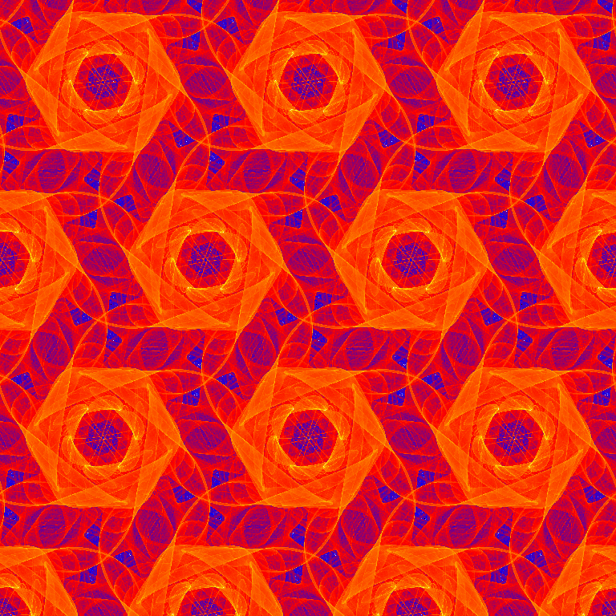
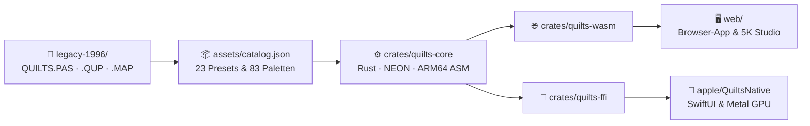

# Quilts – Symmetric Chaos on the Torus (1996 → 2026)

Periodische chaotische Attraktoren (*„Symmetric Quilts“*) und symmetrische Abbildungen nach **Michael Field** und **Martin Golubitsky** – von einer MS-DOS-Implementierung in Turbo Pascal aus dem März 1996 in die moderne Welt übertragen.

<p align="center">
  
  <br />
  <em>Hexagonaler Quilt (𝔻₆-Symmetrie, Standardparameter von 1996) eingefärbt mit der klassischen Fractint-Palette <code>VOLCANO3.MAP</code>.</em>
</p>

---

## 👤 Autor & KI-Unterstützung

Quilts wurde von Stefan Wolfrum entwickelt, mit KI-Unterstützung durch Google Gemini:

- **Stefan Wolfrum** ([@metawops](https://github.com/metawops))  
  *Idee, mathematische Konzeption, Original-Implementierung 1996 in Borland Turbo Pascal (`QUILTS.PAS`), UI-Design, Kuration historischer Presets & Paletten und Weiterentwicklung.*
- **Google Gemini** (Google DeepMind)  
  *KI-Pair-Programming via Google Antigravity: Dekodierung des 16-Bit Pascal-Codes, mathematische Formalisierung der Hexagonal-Kachelung, Rust/Wasm SIMD128-Engine, Web-Worker-Multithreading, Ultra-HD Wallpaper Studio und Web-Benutzungsoberfläche.*

---

## Persönliche Historie: März 1996 bis heute

Im **März 1996** entstand die ursprüngliche Version dieses Programms – **`QUILTS.PAS` (Quilts V1.1)** – in **Borland Turbo Pascal** unter **MS-DOS**. Inspiriert durch das Buch *Symmetry in Chaos* (dt. *Chaotische Symmetrien*) von Michael Field und Martin Golubitsky war das Ziel, die darin beschriebenen periodischen Torus-Attraktoren („Quilts“) selbst zu berechnen, interaktiv zu erforschen und hochauflösend einzufärben.

### Technische Eckdaten des Originals von 1996 ([`legacy-1996/QUILTS.PAS`](legacy-1996/QUILTS.PAS))
- **Umgebung & Grafik:** Rund 2.233 Zeilen Turbo Pascal mit dem BGI-Treiber `SVGA256.BGI` für 256-Farben-SVGA-Auflösungen unter MS-DOS.
- **Zwei Symmetriegitter:** Vollständige Implementierung sowohl **quadratischer Quilts** (`iterateQuad`, $\mathbb{D}_4$- bzw. $\mathbb{Z}_4$-Symmetrie auf dem Einheitsquadrat) als auch **hexagonaler Quilts** (`iterateHex`, $\mathbb{D}_6$- bzw. $\mathbb{Z}_6$-Symmetrie auf dem hexagonalen Gitter).
- **2D-Dichte-Histogramm & Kachelung:** Während der Iteration wurden die Trefferhäufigkeiten pro Pixel gezählt (`mcount`) und die Grundzelle periodisch zu einem nahtlosen $n \times n$-Teppich (*Quilt*) gekachelt – wahlweise Punkt für Punkt während der Rechnung oder im schnellen Block-Kopiermodus (`fastMode` via `GetImage`/`PutImage`).
- **Farbpaletten & Editor:** Direkte Unterstützung der klassischen `.MAP`-Farbpaletten aus *Fractint* (83 Palettendateien von `ALTERN.MAP` über `FIRESTRM.MAP` und `ROYAL.MAP` bis hin zu eigenen Kreationen wie `STEFAN1.MAP`) sowie ein direkt in die SVGA-Benutzungsoberfläche integrierter **RGB-Paletten-Editor** mit Farbverlaufs-Interpolation (`[=] create range`) und Schwellenwert-Filterung (`lowBorder`).
- **Parameter-Presets (`.QUP`):** 21 gespeicherte Parameterdateien (`DEFAULT.QUP`, `ABB2_6.QUP` bis `ABBD_9.QUP`), die exakt die Buch-Abbildungen aus *Symmetry in Chaos* rekonstruieren.
- **Bildexport:** Eigener Encoder für unkomprimierte, farbpalettenbasierte 8-Bit-Truevision-TGA-Dateien (`.TGA`), um die berechneten Grafiken verlustfrei abzuspeichern.
- **Erster Windows-Ansatz (April 1996):** Nur wenige Wochen später entstand im April 1996 ein erster Entwurf einer ereignisgesteuerten Windows-Benutzungsoberfläche in **Borland Delphi** (`uMain.pas`, `uMatPara.pas`, `uImgPara.pas`), der jedoch ein unvollendeter Prototyp blieb.

---

## Quilts V2.0 (2026): Modulare Architektur & High-Speed-Features

Fast genau dreißig Jahre nach den ersten Zeilen in Turbo Pascal wurden alle Originaldateien von einer alten Diskette gerettet und in einer modernen, modularen Multi-Target-Architektur neu implementiert:

### 1. 🖼 5K / Dual-5K Ultra-HD Wallpaper Studio
Da die chaotischen Attraktoren auf dem Torus doppelt-periodisch sind, lassen sie sich ohne jede geometrische Verzerrung auf beliebige Breitbild-Formate ($16:9$, $32:9$, $4:3$, $1:1$) kacheln:
- **Dual 5K Multi-Monitor Split (`2× 5120×2880 px`):** Berechnet ein nahtlos verbundenes $10240 \times 2880$-Panorama ($32:9$, 29,5 Megapixel) und exportiert automatisch zwei passgenau aneinander anschließende 5K-PNG-Dateien (`_5K_LEFT` und `_5K_RIGHT`) für zwei nebeneinander stehende 5K-Monitore.
- **Weitere Direkt-Presets:** Apple 5K Studio Display ($5120 \times 2880$), Apple 6K Pro Display XDR ($6016 \times 3384$), 4K UHD ($3840 \times 2160$), iPad Pro 13" ($2752 \times 2064$) und 4K-Kunstdruck-Quadrat ($4096 \times 4096$).
- **Sofort-Export & Exaktes Quantil-/CDF-Color-Matching:** Wahlweise wird direkt das im Hauptfenster über Milliarden Iterationen gereifte, rauschfreie Live-Histogramm mit bilinearer Subpixel-Kantenglättung in unter einer Sekunde exportiert – oder ein eigenes Ultra-HD-Histogramm ($1440 \times 1440$ bzw. $2048 \times 2048$ Pixel pro Einzelkachel) neu berechnet und über *Cumulative Distribution Function (CDF) Matching* exakt auf die Farbverteilung des Live-Bildes abgeglichen.
- **Live-Kompositionsvorschau:** Freie Wahl der vertikalen Kachel-Wiederholungen sowie horizontaler/vertikaler Phasen-Verschiebung $(u_0, v_0)$ mit eingezeichneter Monitor-Trennlinie.

### 2. ⚡ Multi-Backend Hardware-Benchmark-Arena
Um zu erforschen und direkt zu messen, welchen Geschwindigkeitsgewinn moderne Compiler-, Vektor- und GPU-Technologien gegenüber dem 1996er Algorithmus erzielen, lassen sich verschiedene Rechen-Backends live umschalten und in einer integrierten **Benchmark-Arena** gegeneinander vermessen (Durchsatz in **Millionen Iterationen pro Sekunde, MIt/s**):

| Zielplattform | Verfügbare Compute-Engines | Technische Besonderheiten |
| :--- | :--- | :--- |
| **Rust Core (`crates/quilts-core`)** | 1. `Scalar1996`<br>2. `ScalarFastTrig`<br>3. `Simd4xMultiOrbit`<br>4. `Arm64HandAssembly`<br>5. `MultiCoreParallel` | • 1:1 Turbo-Pascal-Referenz<br>• Verzweigungsfreies Modulo-1 (`floor`) + Chebyshev-Rekursion<br>• Hardware-SIMD (**ARM64 NEON Intrinsics** / **x86 AVX2** / **Wasm SIMD128**)<br>• Handgeschriebener **ARM64-NEON-Inline-Assembler (`asm!`)** mit Register-Pinning (`v0..v28`), `frintm.4s` & `fmla.4s`<br>• Multi-Thread-Skalierung über alle Performance-Kerne |
| **Moderne Web-App (`web/`)** | 1. `Pascal 1996 Skalar`<br>2. `JS Branchless + Chebyshev`<br>3. `Rust / WebAssembly`<br>4. `Multi-Core Web Worker Pool` | • Zero-Build ES-Module & Transferable `Uint32Array`-Buffers<br>• Parallele Berechnung auf allen CPU-Kernen via Web Workers (~150–250+ MIt/s im Browser auf Apple M4 Pro) |
| **Native Apple App (`apple/QuiltsNative`)** | 1. `Pascal 1996 Scalar`<br>2. `Swift SIMD4`<br>3. `Apple Accelerate (vForce)`<br>4. `Apple Metal GPU Compute` | • Native SwiftUI-Benutzungsoberfläche für macOS, iPadOS & iOS<br>• **Metal Compute Shader** ([`QuiltsCompute.metal`](apple/QuiltsNative/Sources/QuiltsCompute.metal)) mit 16.384 parallelen GPU-Trajektorien, Hardware-SFU `fast::sin`/`cos` und `atomic_uint`-Akkumulation im Unified Memory |

### 3. 🎨 Interaktive Echtzeit-Benutzungsoberfläche
- **23 historische `.QUP`-Presets & 83 Fractint `.MAP`-Paletten:** Direkt integriert in [`assets/catalog.json`](assets/catalog.json) und [`web/assets-data.js`](web/assets-data.js).
- **Verzögerungsfreie Paletten-Manipulation:** Genau wie 1996 über die VGA-DAC-Register (`Port[$3c8]`) wirken Palettenwechsel (inkl. Live-Hover-Preview!), `lowBorder`, `blackIndex`, Kontrast/Gamma, Echtzeit-Farbrotation (*Color Cycling*) und der Wechsel zwischen klassischem 1996er-Clamping (`<= 254`) und logarithmischem HDR-Tone-Mapping in Echtzeit ohne Neu-Iteration.
- **16×16 RGB-Paletten-Editor:** Nachbildung von `colorEdit` aus `QUILTS.PAS` mit Farbmarkierung, Verlaufs-Interpolation (`[=] Spread`), Kopieren/Tauschen und `.MAP`-Export.
- **Originalgetreuer `.TGA`-, `.PNG`- & `.QUP`-Export:** Exportiert sowohl hochauflösende PNGs als auch unkomprimierte, farbpalettenbasierte 8-Bit-Truevision-TGA-Dateien nach der Spezifikation von 1996.

---

## Architektur & Projektstruktur



| Verzeichnis / Pfad | Inhalt & Aufgabe |
| :--- | :--- |
| **[`assets/`](assets/)** | [`catalog.json`](assets/catalog.json) (alle 23 `.QUP`-Presets & 83 `.MAP`-Paletten) sowie [`examples/`](assets/examples/) (Showcase-Galerie) |
| **[`crates/quilts-core/`](crates/quilts-core/)** | Plattformunabhängiger Rust-Rechenkern (`Scalar1996`, `ScalarFastTrig`, `Simd4xMultiOrbit`, `Arm64HandAssembly`, `MultiCoreParallel`) & Widescreen-Renderer |
| **[`crates/quilts-ffi/`](crates/quilts-ffi/)** | Zero-Copy C-ABI-Brücke inkl. Header [`quilts_ffi.h`](crates/quilts-ffi/include/quilts_ffi.h) für Swift/Xcode |
| **[`crates/quilts-wasm/`](crates/quilts-wasm/)** | WebAssembly-Wrapper (`wasm32-unknown-unknown`) für Browser |
| **[`web/`](web/)** | Moderne Web-App (HTML5 2D-Canvas, Multi-Core Web Worker Pool, **5K / Dual-5K Wallpaper Studio**, 16×16 Paletten-Editor & Benchmark-Arena) |
| **[`apple/QuiltsNative/`](apple/QuiltsNative/)** | Natives Swift / SwiftUI Projekt für macOS, iPadOS & iOS (`SIMD4`, Apple `Accelerate` & Metal GPU Compute Shader [`QuiltsCompute.metal`](apple/QuiltsNative/Sources/QuiltsCompute.metal)) |
| **[`legacy-1996/`](legacy-1996/)** | Gerettete Originaldateien von März/April 1996 ([`QUILTS.PAS`](legacy-1996/QUILTS.PAS), `.QUP`, `.MAP`, Delphi-Prototyp) |
| **[`references/`](references/)** | Mathematische Referenzliteratur ([`symmetric_chaos.pdf`](references/symmetric_chaos.pdf) von Field & Golubitsky, 1990) |

---

## Schnellstart

### 1. Web-App im Browser starten (Safari, Chrome, Firefox)
```zsh
python3 -m http.server 8080 --directory web
```
Anschließend im Browser [`http://localhost:8080`](http://localhost:8080) öffnen.

### 2. Rust-Rechenkern & CLI-Benchmark-Arena ausführen
```zsh
cargo run --release -p quilts-core --bin bench_arena
```

### 3. Native macOS / iPadOS App (Swift & Metal GPU) starten
```zsh
cd apple/QuiltsNative
swift run -c release
```

---

## Mathematischer Hintergrund

Die zugrunde liegende Mathematik verbindet **chaotische dynamische Systeme** mit **diskreten Symmetriegruppen** in der Ebene ($\mathbb{R}^2 \cong \mathbb{C}$) und auf dem zweidimensionalen Torus ($\mathbb{T}^2 = \mathbb{R}^2 / \mathcal{L}$). Obwohl einzelne Trajektorien empfindlich von den Anfangsbedingungen abhängen (Chaos), besitzt das invariante Maß des Attraktors im Grenzwert vieler Iterationen exakt die Symmetrie der zugrunde liegenden Gruppe $\Gamma$.

### 1. Symmetrische Torus-Abbildungen („Quilts“)

Betrachtet wird der zweidimensionale Torus $\mathbb{T}^2 = \mathbb{R}^2 / \mathcal{L}$, wobei $\mathcal{L}$ ein ebenes Gitter ist (das Einheitsquadrat-Gitter $\mathbb{Z}^2$ oder das hexagonale Gitter). Eine Abbildung $g: \mathbb{T}^2 \to \mathbb{T}^2$ lässt sich zu einer Abbildung $f: \mathbb{R}^2 \to \mathbb{R}^2$ der Form

$$f(X) = p(X) + L(X)$$

liften, wobei $p(X + \ell) = p(X)$ für alle $\ell \in \mathcal{L}$ doppelt-periodisch ist und $L$ eine lineare Abbildung bezeichnet, die das Gitter $\mathcal{L}$ invariant lässt. Fordert man, dass $f$ mit der Symmetriegruppe (Holohedrie) des Gitters kommutiert (bzw. bis auf Drehsymmetrie kommutiert), entstehen bei der Iteration $X_{k+1} = f(X_k) \bmod \mathcal{L}$ beschränkte chaotische Attraktoren, die sich periodisch in der Ebene als nahtlose **Quilt-Muster** aneinanderfügen lassen.

#### A. Quadratische Quilts ($\mathbb{D}_4$- und $\mathbb{Z}_4$-Symmetrie)
Auf dem Einheitsgitter $[0, 1)^2$ lautet die im Artikel [`references/symmetric_chaos.pdf`](references/symmetric_chaos.pdf) (Gleichung 1f) eingeführte $\mathbb{D}_4$-symmetrische Grundform:

$$f(x, y) = \lambda \begin{pmatrix} \sin(2\pi x) \\ \sin(2\pi y) \end{pmatrix} + \alpha \begin{pmatrix} \sin(2\pi x)\cos(2\pi y) \\ \sin(2\pi y)\cos(2\pi x) \end{pmatrix} + \beta \begin{pmatrix} \sin(4\pi x) \\ \sin(4\pi y) \end{pmatrix} + \gamma \begin{pmatrix} \sin(6\pi x)\cos(4\pi y) \\ \sin(6\pi y)\cos(4\pi x) \end{pmatrix} + m \begin{pmatrix} x \\ y \end{pmatrix} \pmod 1$$

In *Symmetry in Chaos* (1992) und in `QUILTS.PAS` (`iterateQuad`) ist diese Vorschrift zusätzlich um einen **Chiralitäts-/Symmetriebrechungsterm $\omega$** (bricht die Spiegelsymmetrie von $\mathbb{D}_4$ auf die reine Vierfach-Drehsymmetrie $\mathbb{Z}_4$) sowie eine **Gitterverschiebung $\text{shift}$** erweitert:

$$\begin{aligned}
x_{\text{neu}} &= \bigl((\lambda + \alpha \cos(2\pi y))\sin(2\pi x) - \omega \sin(2\pi y) + \beta \sin(4\pi x) + \gamma \sin(6\pi x)\cos(4\pi y) + m \cdot x + \text{shift}\bigr) \bmod 1 \\
y_{\text{neu}} &= \bigl((\lambda + \alpha \cos(2\pi x))\sin(2\pi y) + \omega \sin(2\pi x) + \beta \sin(4\pi y) + \gamma \sin(6\pi y)\cos(4\pi x) + m \cdot y + \text{shift}\bigr) \bmod 1
\end{aligned}$$

mit reellen Parametern $\lambda, \alpha, \beta, \gamma, \omega, \text{shift} \in \mathbb{R}$ und ganzzahligem Gitterfaktor $m \in \mathbb{Z}$.

#### B. Hexagonale Quilts ($\mathbb{D}_6$- und $\mathbb{Z}_6$-Symmetrie)
Auf dem hexagonalen Gitter mit den Basisvektoren $k_1 = (1, 0)^T$ und $k_2 = \bigl(\tfrac{1}{2}, \tfrac{\sqrt{3}}{2}\bigr)^T$ nutzt `iterateHex` drei um $120^\circ$ gedrehte Wellenvektor-Systeme erster, zweiter und dritter harmonischer Ordnung. Die Iteration koppelt den linearen Gitteranteil $(a x - b y,\; a y + b x)$ mit den trigonometrischen Summen der Parameter $\lambda, \alpha, \beta, \gamma, \omega$, transformiert die Koordinaten über

$$b_y = \frac{2}{\sqrt{3}}\, y_{\text{neu}}, \qquad b_x = x_{\text{neu}} - \frac{1}{2}\, b_y$$

in das schiefwinklige Fundamentalgebiet $[0, 1)^2$, reduziert modulo $1$ und projiziert für den nächsten Iterationsschritt zurück in kartesische Koordinaten.

---

### 2. Planare symmetrische Attraktoren („Symmetric Icons“)

Neben den Torus-Abbildungen beschreibt das im Projekt abgelegte Referenz-Paper [`references/symmetric_chaos.pdf`](references/symmetric_chaos.pdf) auch die Familie der $\mathbb{D}_n$- und $\mathbb{Z}_n$-äquivarianten Abbildungen in der komplexen Ebene $\mathbb{C}$ (mit $u = z\bar{z} = |z|^2$ und $v = z^n$):

$$f(z) = \bigl(\lambda + \alpha u + \beta \operatorname{Re}(v) + \omega i\bigr)z + \gamma \bar{z}^{n-1} + \delta \bigl(\operatorname{Re}((z/|z|)^n)\bigr)^p \frac{z}{|z|}$$

- Für $\omega = 0$ und $\delta = 0$ ergibt sich die klassische polynomiale $\mathbb{D}_n$-Familie (Gleichung 1a).
- Für $\omega \neq 0$ wird die Spiegelsymmetrie zu $\mathbb{Z}_n$ gebrochen (Gleichung 1c).
- Für $\delta \neq 0$ entsteht nahe dem Ursprung $z = 0$ eine zusätzliche nicht-polynomiale Skalierungsstruktur (Gleichung 1d).

---

### 3. Visualisierung über das invariante Maß (Dichte-Färbung)

Sowohl das von Field & Golubitsky entwickelte Programmpaket *Prism* (`iter` & `draw`) als auch `QUILTS.PAS` visualisieren nicht bloß die Punktmenge des Attraktors, sondern dessen **invariantes Maß** (Wahrscheinlichkeitsdichte):

1. Nach dem Verwerfen einer kurzen Einschwingphase (*Transienten*) wird die Abbildung millionenfach iteriert.
2. Für jedes getroffene Pixel $(i, j)$ wird ein Zähler $H(i, j)$ inkrementiert.
3. Da die Trefferverteilung extrem steil verläuft (typischerweise liegen über $95\,\%$ aller getroffenen Pixel im Bereich kleiner Trefferzahlen, während scharfe Kaustiken und Faltkanten extrem hohe Spitzenwerte aufweisen), wird die Trefferzahl über Farbpaletten bzw. nichtlineare Farbbänder auf RGB-Werte abgebildet.

---

## Literatur & Referenzen

1. **Originalartikel (im Repository als Referenz enthalten):**
   - **Mike Field, Martin Golubitsky:** *„Symmetric Chaos: A pictorial exploration of an order imposed by symmetry within chaotic systems“*, in: **Computers in Physics**, Vol. 4, No. 5 (Sep/Oct 1990), S. 470–479. ([`references/symmetric_chaos.pdf`](references/symmetric_chaos.pdf), [DOI: 10.1063/1.4822939](https://doi.org/10.1063/1.4822939))
2. **Das Standardwerk (Hauptquelle für `QUILTS.PAS` und die `.QUP`-Parameterdateien):**
   - **Michael Field, Martin Golubitsky:** *Symmetry in Chaos: A Search for Pattern in Mathematics, Art and Nature*, Oxford University Press, Oxford / New York, **1992**, ISBN 978-0-19-853689-5.
   - **Deutsche Ausgabe:** *Chaotische Symmetrien: Die Suche nach Mustern in Mathematik, Kunst und Natur*, Birkhäuser Verlag, Basel / Boston / Berlin, **1993**, ISBN 978-3-7643-2844-3.
   - **2., überarbeitete Auflage:** *Symmetry in Chaos: A Search for Pattern in Mathematics, Art, and Nature* (2nd Edition), Society for Industrial and Applied Mathematics (SIAM), Philadelphia, **2009**, ISBN 978-0-89871-672-6. ([SIAM Bookstore / DOI: 10.1137/1.9780898717709](https://epubs.siam.org/doi/book/10.1137/1.9780898717709))
3. **Weiterführende mathematische Grundlagen:**
   - **Pascal Chossat, Martin Golubitsky:** *„Symmetry-increasing bifurcation of chaotic attractors“*, in: **Physica D: Nonlinear Phenomena**, Vol. 32, Issue 3 (1988), S. 423–436. ([DOI: 10.1016/0167-2789(88)90066-8](https://doi.org/10.1016/0167-2789(88)90066-8))
   - **Greg King, Ian Stewart:** *„Symmetric Chaos“*, in: *Nonlinear Equations in the Applied Sciences* (W. F. Ames, C. Rogers, Hrsg.), Academic Press, 1992, S. 257–315.

---

## Fractint-Paletten & Urheberrechte

Die im Projekt enthaltenen **83 Farbtabellen** (Dateiformat `.MAP` mit jeweils 256 RGB-Farbtriplets) stammen aus dem legendären Fraktalprogramm **Fractint** der *Stone Soup Group* (Bert Tyler, Timothy Wegner, Mark Peterson, Pieter Branderhorst u. a., 1988–2000). Sie wurden in den 1990er-Jahren von Enthusiasten der weltweiten Fraktal-Community als Freeware beigesteuert.

Die Paletten werden in Quilts V2 zu reinen Dokumentations-, Bildungs- und Nostalgiezwecken bereitgestellt, um das historische visuelle Erscheinungsbild von 1996 originalgetreu wiederzubeleben. Sämtliche Urheberrechte an den individuellen Farbgradienten verbleiben bei den jeweiligen ursprünglichen Autoren.

---

## KI-Pair-Programming mit Google Gemini

Quilts V2 entstand im Oktober 2026 im intensiven Pair-Programming zwischen **Stefan Wolfrum** und **Google Gemini** (Google DeepMind) in der agentischen Entwicklungsumgebung **Google Antigravity**.

Von der Rekonstruktion des historischen 16-Bit Real-Mode Pascal-Codes (`QUILTS.PAS`) über die mathematische Formulierung der hexagonalen Kachelung und bilinearen Subpixel-Glättung bis hin zur hochoptimierten SIMD128-Vektorisierung in Rust/WebAssembly, Multithreading-Architektur mit Web Workern und der interaktiven Web-Benutzungsoberfläche wurde das gesamte System kollaborativ entworfen, implementiert und getestet.

---

## Lizenz

Dieses Projekt steht unter der **MIT License** – siehe [`LICENSE`](LICENSE) für Details (`Copyright (c) 1996, 2026 Stefan Wolfrum`).
